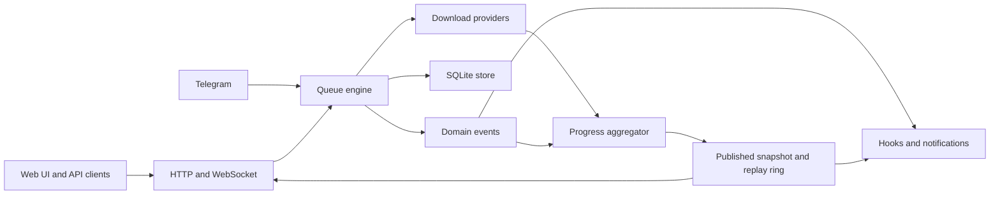

# Architecture

Aulos is a Rust workspace with one server binary. The server owns queue state, SQLite persistence,
provider processes, HTTP and WebSocket access, subscriptions, and notifications.

Use [configuration](configuration.md) for settings and [Protocol v2](PROTOCOL.md) for wire types.

## Components

| Crate | Responsibility |
|---|---|
| `aulos-core` | Domain types, configuration, IDs, errors, events and shared ports. |
| `aulos-store` | SQLite writer, reader pool, migrations and explicit JSON import. |
| `aulos-provider` | Provider trait, registry, command plugins and process handling. |
| `aulos-provider-ytdlp` | yt-dlp options, format selection and Python shim transport. |
| `aulos-provider-sc` | StreamingCommunity metadata, download engines and progress parsing. |
| `aulos-queue` | Resolution, scheduling, cancellation, recovery and published state. |
| `aulos-api` | REST, WebSocket, authentication, file serving and embedded web UI. |
| `aulos-subscriptions` | Subscription checks, seen IDs and scheduling. |
| `aulos-telegram` | Bot commands, progress messages and notifications. |
| `aulos-apns` | Device push and Live Activity updates for the iOS app (private alpha). |
| `aulos-hooks` | Audio sync, NFO, Jellyfin and community hooks. |
| `aulos-server` | CLI, startup wiring, supervisors, health and shutdown. |
| `aulos-workspace-tests` | Architecture, packaging and cross-crate tests. |

## Dependency rules

The architecture tests enforce these rules, including development dependencies where applicable:

| Rule | Constraint |
|---|---|
| A1 | Provider crates cannot depend on the store or queue. |
| A2 | Only the store depends on `rusqlite`. |
| A3 | Only the API and server depend on `axum`. |
| A4 | Only the server depends on the API crate. |
| A5 | Only the server uses `anyhow` in shipped dependencies. |

**Shared dependencies.** `serde`, `serde_json`, `thiserror`, `tracing` and `async-trait` are allowed
in every crate. Rule A5 limits `anyhow` to `aulos-server`.

The per-crate dependency allowlist is maintained in
[arch.rs](../crates/aulos-workspace-tests/tests/arch.rs). Library interfaces use typed errors and
ports from core to avoid depending on concrete services.

## Identity and state

Every item has an immutable ULID `id` and a persistent integer `ord`. Clients identify records by
`id` and sort by `ord`, then `id`. A URL is data and may occur in more than one record.

A playlist begins as a resolving item. It becomes a group with the same ID and order value, then
receives child records. Groups aggregate child state and never download a file themselves.

The status values are `queued`, `resolving`, `preparing`, `downloading`, `postprocessing`,
`finished`, `error` and `canceled`. A paused item is `queued` with `auto_start=false`.
The original `source` attribution survives retries and recovery.

Selection and request settings are persisted. Progress measurements are kept in memory.
`ItemView` is the shared full representation used by REST, snapshots and item events.

## Storage

SQLite runs in WAL mode. One writer actor serializes mutations and batches eligible writes.
A separate reader pool handles history and metadata queries. Schema migrations run when the
store opens. ID-order and frame-sequence allocators reserve ranges before use, so a crash can
leave gaps without reusing issued values.

The published state contains every non-terminal record, group records and a bounded window of
terminal records. Older history stays in SQLite and is available through paginated queries.
State reads use an `ArcSwap` snapshot instead of querying the database for each progress update.

The MeTube JSON importer is an explicit CLI operation. Normal startup opens SQLite and checks
whether legacy JSON needs migration. It does not import automatically. See
[the import procedure](operations.md#importing-metube-state).

## Queue and providers

An add request validates input and writes provisional records before acknowledging acceptance.
Resolution runs in a separate pool. The engine selects a provider, follows supported extractor
redirects, expands groups, and schedules children when slots are available.

The registry scores URL matches. A degraded matching provider remains visible and reports its
failure. If a ready provider returns unsupported, the engine can try one ready runner-up.
yt-dlp is the catch-all provider. StreamingCommunity uses its own download slots.

Each yt-dlp job runs through a Python shim with a JSON request and JSON-line output. Rust owns
options, process lifetime, progress normalization and error mapping. Single-item downloads force
`noplaylist`, including previously queued items. Playlist expansion belongs to resolution.

StreamingCommunity resolves site metadata and stream URLs, then downloads with N_m3u8DL-RE or
ffmpeg. Its default HTTP client supports browser impersonation; a plain client is also available.
Command providers use the [plugin manifest](plugins.md).

Pause keeps partial files where the provider supports resume. Cancel removes scratch files.
Retries increment `attempt`. Boot recovery resumes or pauses interrupted work according to
`AULOS_RESTART_POLICY`.

## Events and realtime updates

Providers send progress through a dedicated channel. The aggregator merges it with item state,
compares fields with the last published view, and emits patches. Numeric updates use the configured
batch cadence; status and text changes request an urgent flush.

Domain events carry lifecycle changes to the aggregator, hook dispatcher, Telegram and APNs.
Subscribers have bounded queues. Telegram and APNs read live progress from the published snapshot
instead of adding progress traffic to lifecycle event queues.

The event hub serializes broadcast frames once, publishes them to connected clients and retains a
bounded replay ring. The aggregator publishes the matching state generation after a flush.
Clients reconnect with both a sequence cursor and a boot ID. An unavailable replay window or a
different boot produces a new snapshot.

Snapshots include active group children. Group watch subscriptions and topic filtering are not
implemented. `AULOS_SNAPSHOT_GROUP_INLINE` is accepted but unused. See
[WebSocket behavior](PROTOCOL.md#5-websocket).

## Hooks and notifications

The audio-sync hook runs before a successful item is finalized. NFO generation and library
refresh run after completion. Community hooks can run commands or HTTP requests for selected
terminal outcomes. Hook failures are logged and counted.

The server constructs community hooks at startup. Provider manifests can reload into the
registry for new jobs; the running hook dispatcher is not rebuilt by that reload.

Notification routing uses the original item source and optional iOS install ID. Telegram reports
its own downloads and subscriptions by default. APNs reports iOS-origin downloads to eligible
devices. Operator settings can widen both routes. See [integrations](integrations.md).

## HTTP and web UI

The API serves v2 routes only. REST mutations use item IDs. The WebSocket sends state changes and
accepts connection-control messages; mutations stay on REST.

The web UI is embedded from `crates/aulos-api/web`. It has no runtime Node dependency. The root
route returns HTML for an HTML `Accept` header and a JSON identity otherwise. API routes, the
WebSocket and downloaded files share the configured authentication checks. Static UI and health
routes remain public at the server layer.

File paths are checked against the download roots. File responses support byte ranges. Content
that is not on the inline-media allowlist is served as an attachment. See
[operations](operations.md#authentication-and-network-access).

## Process lifecycle

The container uses `tini` as PID 1. Its entrypoint sets ownership and permissions, then starts the
server as the configured user. The server supervises BgUtils POT and launches provider and hook
children in separate process groups.

Cancellation signals the process group and escalates to SIGKILL after the configured grace.
Startup checks required tools and reports optional failures through health. Transient optional
failures are retried in the background.

Shutdown stops admission, gives active downloads their grace period, cancels remaining work,
closes WebSockets, drains background consumers and closes the store. The store checkpoints WAL
before exit. Compose needs enough stop time for the entire sequence.

`healthz` reports component state; `livez` reports process liveness. Prometheus export is not
implemented. Build, test and release workflows are documented in [development](development.md).
